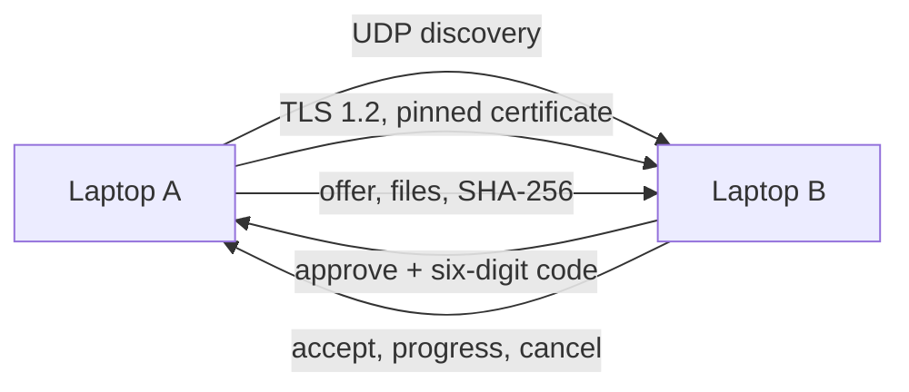

# LanBridge

[](https://github.com/SMR-2009/lanbridge/actions/workflows/build.yml)
[](https://github.com/SMR-2009/lanbridge/releases)
[](LICENSE)


**A tiny Windows tray app for sending files directly between two laptops on the same Wi-Fi.**

No account. No cloud. No cable. Pair once with a six-digit code, then use the tray menu.

> **Status:** early `0.1.0`. The core flow is tested; expect rough edges. Security reports are welcome.

## Install

### One command

On **both** laptops, open PowerShell and run:

```powershell
[Net.ServicePointManager]::SecurityProtocol = [Net.SecurityProtocolType]::Tls12; irm https://github.com/SMR-2009/lanbridge/releases/latest/download/install.ps1 | iex
```

The TLS prefix is for older Windows PowerShell 5.1 installations; it is harmless on PowerShell 7. The installer:

- downloads the latest release and verifies its SHA-256;
- installs per-user to `%LOCALAPPDATA%\Programs\LanBridge`;
- adds a Start Menu shortcut;
- creates the firewall rule with **one UAC prompt**;
- launches LanBridge.

No admin rights are needed for normal use. If you decline the firewall prompt, outbound sends still work and the rule can be repaired later in **Settings → Repair firewall rule**.

### Manual download

Download `lanbridge-v0.1.0-win.zip` or `LanBridge.exe` from the [latest release](https://github.com/SMR-2009/lanbridge/releases/latest). Extract the zip, then run `install.ps1` from that folder:

```powershell
.\install.ps1 -SourceDir .
```

If you prefer the exe alone, run it and approve the one-time firewall prompt on first launch.

### Uninstall

```powershell
[Net.ServicePointManager]::SecurityProtocol = [Net.SecurityProtocolType]::Tls12; irm https://github.com/SMR-2009/lanbridge/releases/latest/download/uninstall.ps1 | iex
```

Received files and app data are kept unless you pass `-RemoveData`. The uninstaller asks once for UAC to remove the firewall rule.

## Pair once

1. Make sure LanBridge is running on both laptops and both are on the same Wi-Fi or Ethernet network.
2. On laptop A, right-click the LanBridge tray icon → **Send files…** → pick the other laptop.
3. Laptop B shows **“Rohan-Laptop wants to pair”**. Approve it.
4. Laptop B shows a six-digit code. Type it on laptop A.
5. Both laptops remember each other. The next send is just tray → device → files.

The code is a confirmation step, not a password. It is derived from both certificates and fresh nonces, exists only for two minutes, and is never sent over the network. A man-in-the-middle sees different codes on each side, so pairing fails.

## Send

Right-click the tray icon → **Send files…**, or pick a paired device directly under **Devices**. You can also drag files onto the device list.

The receiving laptop shows the sender, file names, sizes, and total; **Decline** is the default choice. Progress, cancel, duplicate-name handling, and SHA-256 verification are built in. Received files go to `Downloads\LanBridge` by default.

## Screenshots

These are the real WinForms windows, generated with demo data.

| First run | Device list |
| --- | --- |
|  |  |

| Pairing code | Receiving files |
| --- | --- |
|  |  |


## What you get

- **Tray-first flow:** send files without opening a browser or signing in.
- **Pair once:** six-digit confirmation, pinned certificate identity, explicit “Identity changed” warning after a reinstall.
- **Direct LAN transfer:** UDP discovery, TCP over TLS 1.2, no relay or internet dependency.
- **Safe receives:** hostile file names are reduced to safe leaf names; duplicate names get a suffix; files are written to `.part`, verified with SHA-256, then moved into place.
- **Cancel and progress:** per-file progress, sender/receiver cancel, no half-written final files.
- **Hidden mode:** stop advertising on discovery while keeping paired devices working.
- **One UAC:** firewall rule at install; no elevation on every launch.
- **Settings:** device name, receive folder, start with Windows, visibility, auto-accept, firewall repair, logs.
- **No telemetry:** no analytics, update checks, accounts, or cloud calls.

## How it works



- Discovery announcements are **hints**, not trust. A device appears only after a TCP/TLS callback proves it owns the advertised certificate.
- Pairing uses a short authentication string derived from both certificates and fresh nonces. The code is never sent over the wire.
- A paired laptop is trusted by its full SHA-256 certificate fingerprint. A changed certificate is surfaced as **Identity changed** and is never silently re-trusted.
- Transfers are accepted only from physical Wi-Fi/Ethernet subnets; VPN, Hyper-V, Bluetooth, and other virtual adapters are excluded.

Read [docs/protocol.md](docs/protocol.md) for frame types and pairing math, and [docs/design.md](docs/design.md) for product decisions.

## Security at a glance

- **Local only.** No account, cloud, relay, telemetry, or update checks.
- **Mutual TLS with pinning.** Each laptop presents a self-signed certificate; the peer is pinned by full SHA-256 fingerprint after pairing.
- **DPAPI key storage.** The identity key is stored in a DPAPI-encrypted PFX under `%APPDATA%\LanBridge`. See [the security model](docs/security.md) for the Schannel runtime-key fallback.
- **Firewall scope.** The optional rule is program-scoped, applies to Private/Public profiles, and is limited to `RemoteIp=LocalSubnet`.
- **No path traversal.** Remote names are stripped to a leaf name, reserved names are prefixed, and writes are atomic.

Read [docs/security.md](docs/security.md) for the threat model and limitations. Report vulnerabilities privately through GitHub’s Security tab; see [SECURITY.md](SECURITY.md).

## Requirements

- Windows 10 1903 or later, or Windows 11.
- Both laptops on the same Wi-Fi or Ethernet network.
- IPv4. Guest Wi-Fi or client-isolation networks may block discovery and connections.
- No runtime install: the app targets the built-in .NET Framework 4.8.

## Firewall and UAC

Windows requires administrator approval to create an inbound firewall rule. LanBridge asks **once**, at install time.

- The installer creates the rule. If you skip it, first-run setup offers it once more, and **Settings → Repair firewall rule** is always available.
- The rule is program-scoped, covers Private and Public profiles, and is limited to `RemoteIp=LocalSubnet`.
- You should **not** see a UAC prompt every launch. If you do, you are probably launching a different `LanBridge.exe` from a different folder; Windows treats each path as a separate program. Use the installed copy at `%LOCALAPPDATA%\Programs\LanBridge\LanBridge.exe`.
- A Windows Firewall notification is not a UAC prompt. It means the rule is missing; approve it once, or repair the rule in Settings.

## Troubleshooting

| Symptom | Try |
| --- | --- |
| The install command returns 404 | The release may not be published yet, or the latest-release CDN is stale. Open the [releases page](https://github.com/SMR-2009/lanbridge/releases), then retry. |
| “Could not create SSL/TLS secure channel” | Use the TLS-safe install command above, or update Windows. Windows PowerShell 5.1 on old builds defaults to older TLS versions. |
| “Running scripts is disabled” | The one-liner runs in memory and bypasses file policy. If you downloaded a `.ps1`, run `powershell -ExecutionPolicy Bypass -File .\install.ps1`. |
| The other laptop never appears | Make sure both are on the same network, LanBridge is running on both, and **Visible on this network** is checked. Click **Refresh**. Guest Wi-Fi often isolates clients. |
| “Identity changed” after a reinstall | That is the pin doing its job. Unpair the old entry, then pair again with a new code. |
| The transfer is refused as “not reachable” | Windows Firewall may be blocking the app. Open **Settings → Repair firewall rule** and approve the UAC prompt. |
| I get a UAC prompt every launch | Use the installed copy; the rule is tied to its path. Repair it once from Settings if needed. |
| SmartScreen warns on first launch | The 0.1.0 exe is not code-signed. Verify the SHA-256 from the release page, or build it yourself. |
| Sending and receiving at once | Allowed: one inbound and one outbound transfer can run together. A second inbound or outbound transfer is refused as busy. |
| I want to be invisible to discovery | Turn off **Visible on this network**. Paired devices can still send to the last known endpoint. |

Logs are at `%APPDATA%\LanBridge\lanbridge.log`. They contain device names, IP addresses, error codes, and timings, not file contents or pairing codes.

## FAQ

**Does the app need the internet?** Only the installer does. After installation, transfers are local.

**Can I send to a phone or Mac?** Not with LanBridge 0.1.0. [LocalSend](https://localsend.org) covers Windows, macOS, Linux, Android, and iOS.

**Can I send a folder?** Zip it first. Folder-as-one-unit transfer is not implemented yet.

**Can transfers resume?** No. A dropped transfer starts over; completed files are kept.

**Where are received files?** `Downloads\LanBridge` by default. Change it in Settings.

**Why is the exe unsigned?** Code signing requires a paid certificate and hardware token. Verify the release SHA-256 until that changes.

**How many laptops can pair?** As many as you add. The device list keeps paired devices and discovery results separate.

**What happens if I reinstall Windows?** The identity is new, so the other laptop shows **Identity changed**. Unpair and pair again.

## Build from source

Requirements: Windows, .NET SDK 8, and the .NET Framework 4.8 targeting pack (the SDK installs it on Windows).

```powershell
git clone https://github.com/SMR-2009/lanbridge.git
cd lanbridge
dotnet test LanBridge.sln -c Release
.\build.ps1
```

`build.ps1` restores, builds, runs the full suite, and writes the exe, zip, and `SHA256SUMS.txt` to `artifacts/`. Run the app from `src\LanBridge\bin\Release\net48\LanBridge.exe`.

The suite covers framing, TLS pinning, the pairing SAS and proof, filename attacks, peer storage, LAN scope, discovery confirmation, transfer flows, cancellation, firewall arguments, and startup keys. The physical two-laptop gate is [docs/manual-test.md](docs/manual-test.md).

## Project layout

```text
src/LanBridge/
  Core/       protocol, TLS, identity, discovery, transfer, safety
  Forms/      WinForms dialogs
  Program.cs  startup, single instance, crash logging
tests/        xUnit suite (111 tests)
docs/         design, protocol, security, manual test
install.ps1   per-user installer
build.ps1     local release build
```

## Project docs

- [Design](docs/design.md) — product and protocol decisions, including review gaps.
- [Protocol](docs/protocol.md) — wire format, frame types, pairing math, timeouts.
- [Security model](docs/security.md) — assets, adversaries, controls, limitations.
- [Manual two-laptop checklist](docs/manual-test.md) — the release gate.
- [Contributing](CONTRIBUTING.md) — build, tests, review expectations.
- [Changelog](CHANGELOG.md)
- [Code of Conduct](CODE_OF_CONDUCT.md)

## Roadmap

- Code signing when a certificate is available.
- Folder transfer and a “send to last device” shortcut.
- Resume after a dropped connection.
- macOS and Linux clients, if the protocol stays small enough.

## Credits

LanBridge builds on lessons from [LocalSend](https://localsend.org), [KDE Connect](https://kdeconnect.kde.org), and [Warpinator](https://github.com/linuxmint/warpinator). Their security advisories shaped the discovery confirmation, pairing proof, and filename rules here. LanBridge is not affiliated with any of them.

Built by [R. Murtaza](https://github.com/SMR-2009). Made for two laptops on one home network.

## License

MIT — see [LICENSE](LICENSE).
