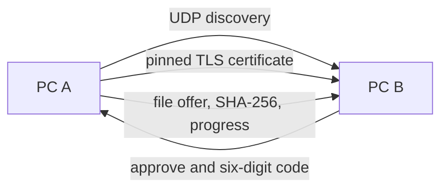
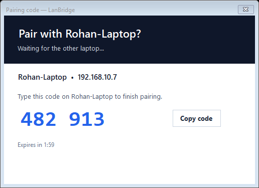
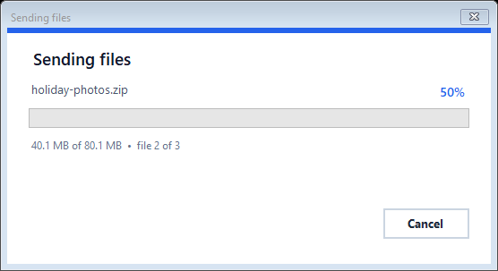

# LanBridge

[](https://github.com/SMR-2009/lanbridge/actions/workflows/build.yml)
[](https://github.com/SMR-2009/lanbridge/actions/workflows/codeql.yml)
[](https://github.com/SMR-2009/lanbridge/releases)
[](LICENSE)


LanBridge sends files directly between two Windows PCs on the same network. It runs in the notification area, pairs with a six-digit code, and keeps transfers local.

No account, no cloud relay, no browser tab.

## What it does

- Pairs two PCs once, then sends files without a code.
- Transfers over TLS with pinned certificates, not plain FTP or an open share.
- Checks every file with SHA-256 before it leaves the partial state.
- Keeps an interrupted transfer resumable instead of starting over.
- Stays out of the way in the tray.

## Install

On both PCs, open PowerShell and run:

```powershell
[Net.ServicePointManager]::SecurityProtocol = [Net.SecurityProtocolType]::Tls12; irm https://github.com/SMR-2009/lanbridge/releases/latest/download/install.ps1 | iex
```

The TLS prefix is for Windows PowerShell 5.1. It is harmless on PowerShell 7.

The installer:

- downloads the latest release and checks its SHA-256;
- installs to `%LOCALAPPDATA%\Programs\LanBridge`;
- adds a Start Menu shortcut;
- enables start at sign-in;
- adds a firewall rule scoped to the local subnet, with one UAC prompt;
- launches LanBridge.

Use `-NoFirewall` to skip the firewall rule. Use `-NoStartup` to skip start at sign-in.

### Manual install

Download the `lanbridge-v*-win.zip` asset from the [latest release](https://github.com/SMR-2009/lanbridge/releases/latest), extract it, then run:

```powershell
.\install.ps1 -SourceDir .
```

The zip contains `SHA256SUMS.txt`; the installer verifies the executable against it.

### First run

Choose a device name and a receive folder. The default receive folder is `Downloads\LanBridge`. If the installer already added the firewall rule, setup detects it and does not ask again.

## Pair

1. Put both PCs on the same Wi-Fi or Ethernet network and start LanBridge on both.
2. On one PC, right-click the tray icon, choose **Send files...**, then choose the other PC.
3. On the other PC, approve the pairing request.
4. It shows a six-digit code. Type that code on the first PC.
5. Both PCs pin each other's certificate. Future sends do not need a code.

The six-digit code is derived from both certificates and fresh nonces. It never crosses the network. A man-in-the-middle sees a different code on each screen, so pairing fails.

## Send

Right-click the tray icon and choose **Send files...**, open **Devices**, or drag files onto the device window.

The receiving PC shows the sender, file names, sizes, and total size. The default choice is **Decline**. Either side can cancel while a transfer is running. The receiver writes to a private partial file, verifies SHA-256, then moves the file into place.

Received files go to `Downloads\LanBridge` by default. Change the folder in **Settings**. A single inbound offer is limited by the configured maximum receive size, 100 GB by default.

## Safety and limits

- Pairing pins the full SHA-256 certificate fingerprint. A changed certificate shows as **Identity changed** and is never trusted silently.
- The identity key is protected with DPAPI under `%APPDATA%\LanBridge`.
- The firewall rule is inbound, allow, and limited to `LocalSubnet` for the installed executable.
- Inbound connections and discovery packets use bounded queues.
- File names are reduced to a safe leaf name. Existing files are not overwritten; a numeric suffix is used.
- Interrupted transfers keep a resumable partial in the private `parts` folder. A user cancel removes it.
- Inbound transfers are accepted only from physical Wi-Fi or Ethernet subnets, not VPN, Hyper-V, Bluetooth, or other virtual adapters.
- There is no telemetry, cloud relay, or background update check.
- The executable is not code-signed. Windows SmartScreen may warn on first launch. Check the release SHA-256 before running it.

See [docs/security.md](docs/security.md) for the threat model and the exact limits.

## Update, repair, and uninstall

### Update

LanBridge does not update itself in the background. Open **Devices → More → Check for updates** to compare against the latest GitHub release. The check only opens the release page when a newer version exists; it never downloads or runs anything.

To update, quit LanBridge from the tray and run the install command again. The installer replaces `LanBridge.exe` and keeps:

- your device name and settings in `%APPDATA%\LanBridge`;
- your pairing pins;
- received files;
- the Start Menu shortcut, start at sign-in, and firewall rule.

### Repair

Re-running the installer is also the repair path. It is idempotent and does not touch received files or pairing data.

The app also repairs what it can safely:

- unreadable settings are quarantined and recreated with defaults;
- unreadable pairing data is quarantined, so you pair again;
- a damaged identity is replaced, which intentionally requires re-pairing;
- stale partial files older than one hour are removed from the private `parts` folder at startup.

For a full check, open **Settings → Run repair**. It checks that the receive folder is writable, saves settings, verifies start at sign-in, removes stale partials, and checks the firewall rule's enabled, direction, action, profile, subnet, and executable fields.

### Uninstall

```powershell
[Net.ServicePointManager]::SecurityProtocol = [Net.SecurityProtocolType]::Tls12; irm https://github.com/SMR-2009/lanbridge/releases/latest/download/uninstall.ps1 | iex
```

Received files and settings are kept unless you pass `-RemoveData`.

## How it works



Discovery packets are hints. A PC only appears in the list after a TCP/TLS connection proves it holds the advertised certificate. After pairing, each PC pins the other's full certificate fingerprint.

Transfers use one TCP port and one UDP port. The default is `45873` for both. Control messages are JSON frames; file chunks are length-prefixed binary frames. See [docs/protocol.md](docs/protocol.md) for the wire format.

## Screenshots

| First run | Device list |
| --- | --- |
|  |  |

| Pairing code | Incoming files |
| --- | --- |
|  |  |



## Troubleshooting

| Problem | Check |
| --- | --- |
| Install command returns 404 | Open the [releases page](https://github.com/SMR-2009/lanbridge/releases) and retry. The release may not be published yet. |
| `Could not create SSL/TLS secure channel` | Use the TLS prefix in the install command above, or update Windows. |
| `Running scripts is disabled` | The one-liner runs in memory. If you downloaded the script, run `powershell -ExecutionPolicy Bypass -File .\install.ps1`. |
| The other PC does not appear | Make sure both are on the same network, LanBridge is running on both, and **Visible on this network** is on. Guest Wi-Fi often blocks discovery. If broadcast is blocked, open **Devices → More → Add device by IP...** and enter the other PC's IPv4 address and port. |
| Pairing says **Identity changed** | The pinned certificate changed. Unpair the old entry and pair again. |
| Inbound transfers are refused | Open **Settings → Run repair** and approve the firewall prompt if asked. |
| UAC appears on every launch | Use the installed copy in `%LOCALAPPDATA%\Programs\LanBridge`. A different executable path gets a different firewall rule. |
| SmartScreen warns on first launch | The binary is not signed. Verify the release SHA-256 or build it yourself. |

Logs are at `%APPDATA%\LanBridge\lanbridge.log`. They contain device names, addresses, error codes, and timings, not file contents.

## FAQ

**Does it need the internet?** Only the installer and the optional update check. File transfers stay on the local network.

**Can it send to macOS, Linux, or a phone?** Not in this version. [LocalSend](https://localsend.org) covers those platforms.

**Can it send a folder?** Zip it first. Folder-as-a-unit transfer is not in this release.

**Can a transfer resume?** Yes. After a network interruption, send the same files again. LanBridge verifies the partial prefix and continues. A user cancel removes the partial.

**Where are received files?** `Downloads\LanBridge` by default. Change it in **Settings**.

**Does it start with Windows?** Yes, at sign-in by default. Turn it off in **Settings**, or install with `-NoStartup`.

**Does it need administrator access?** The app itself does not. Windows needs one UAC approval for the inbound firewall rule. If that step is skipped or damaged, **Settings → Run repair** asks again.

**Is it audited?** No third-party audit. The protocol and threat model are documented, the source is public, and the two-PC checklist is in [docs/manual-test.md](docs/manual-test.md).

## Requirements

- Windows 11.
- Both PCs on the same IPv4 Wi-Fi or Ethernet network.
- .NET Framework 4.8, included with supported Windows versions.
- No runtime install. One UAC prompt for the firewall rule.

## Build

Requirements: Windows 11, .NET SDK 10, and the .NET Framework 4.8 targeting pack.

```powershell
git clone https://github.com/SMR-2009/lanbridge.git
cd lanbridge
dotnet test LanBridge.sln -c Release
.\build.ps1
```

`build.ps1` writes the executable, zip, installer, uninstaller, and `SHA256SUMS.txt` to `artifacts`.

The suite covers frame parsing, TLS pinning, pairing, proof verification, filename handling, storage, discovery, transfers, cancellation, resume, firewall arguments, startup registration, and the WinForms pairing dialogs. The physical two-PC check is in [docs/manual-test.md](docs/manual-test.md).

## Project layout

```text
src/LanBridge/
  Core/       protocol, TLS, identity, discovery, transfer, file safety
  Forms/      WinForms dialogs
  Program.cs  startup, single instance, crash logging
tests/        xUnit tests
docs/         protocol, security, manual test
install.ps1   per-user installer
build.ps1     release build
```

## Docs

- [Protocol](docs/protocol.md)
- [Security model](docs/security.md)
- [Manual two-PC test](docs/manual-test.md)
- [Contributing](CONTRIBUTING.md)
- [Changelog](CHANGELOG.md)

## License

MIT. See [LICENSE](LICENSE).
