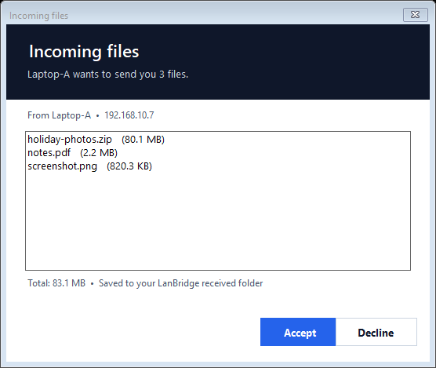

# LanBridge

[](https://github.com/SMR-2009/lanbridge/actions/workflows/build.yml)
[](https://github.com/SMR-2009/lanbridge/releases)
[](LICENSE)


**Send a file to the other laptop. No account, no cloud, no cable.**

LanBridge is a small Windows tray app for direct, local file transfer between two PCs on the same Wi-Fi or Ethernet network. Pair once with a six-digit code, then send files from the tray menu. Everything stays on your LAN.

> **Status:** early `0.1.0`. It does the core job and has a test suite, but expect rough edges. Security reports are welcome.

## Install

On **both** laptops, open PowerShell and run:

```powershell
irm https://github.com/SMR-2009/lanbridge/releases/latest/download/install.ps1 | iex
```

The installer downloads the release, verifies its SHA-256, installs per-user to `%LOCALAPPDATA%\Programs\LanBridge`, adds a Start Menu shortcut, and launches the app. No admin rights are needed for normal use. It also adds the inbound firewall rule with **one UAC prompt**, scoped to the installed exe and your local subnet. If the rule already exists, the installer skips it. If you decline the prompt, the app still works for outbound sends and setup can add the rule later.

Prefer a manual download? Grab `lanbridge-v0.1.0-win.zip` or `LanBridge.exe` from the [latest release](https://github.com/SMR-2009/lanbridge/releases/latest) and compare the SHA-256 with `SHA256SUMS.txt`.

To uninstall:

```powershell
irm https://github.com/SMR-2009/lanbridge/releases/latest/download/uninstall.ps1 | iex
```

Received files and app data are kept unless you pass `-RemoveData`.

## Pair once

1. Make sure LanBridge is running on both laptops and both are on the same Wi-Fi or Ethernet network.
2. On laptop A, right-click the LanBridge tray icon → **Send files…** → pick the other laptop.
3. Laptop B shows **“Rohan-Laptop wants to pair”**. Approve it.
4. Laptop B shows a six-digit code. Type it on laptop A.
5. Both laptops remember each other. The next send is just tray → device → files.

The code is a confirmation step, not a password. It is derived from both certificates and fresh nonces, exists only for two minutes, and is never sent over the network. A man-in-the-middle sees different codes on each side, so pairing fails.

## Send

Right-click the tray icon → **Send files…** or pick a paired device directly under **Devices**. The receiving laptop shows the sender, file names, sizes, and total; **Decline** is the default choice. Progress, cancel, duplicate-name handling, and SHA-256 verification are built in.

Received files go to `Downloads\LanBridge` by default. Change it in **Settings…** or the first-run setup.

## Screenshots

| First run | Device list |
| --- | --- |
|  |  |

| Pairing code | Receiving files |
| --- | --- |
|  |  |


## Security at a glance

- **Local only.** No account, cloud, relay, telemetry, or update checks. Discovery is UDP broadcast; transfers are TCP over TLS 1.2.
- **Pairing with a human check.** The six-digit code is derived from both certificates and fresh nonces; the receiving laptop must approve the pairing.
- **Certificate pinning.** A paired laptop is trusted by its full SHA-256 certificate fingerprint. A changed certificate shows **Identity changed**; LanBridge never silently re-trusts it.
- **DPAPI key storage.** The identity key is stored in a DPAPI-encrypted PFX under `%APPDATA%\LanBridge`. See [the security model](docs/security.md) for the Schannel runtime-key fallback.
- **Hostile names are contained.** Received files are reduced to a safe leaf name, checked for free space, written to `.part`, verified against SHA-256, and moved into place. Existing files are never overwritten.
- **Firewall scope.** The optional rule is program-scoped, applies to Private/Public profiles, and is limited to `RemoteIp=LocalSubnet`.
- **Physical LAN only.** Transfers are accepted only from physical Wi-Fi/Ethernet subnets; VPN, Hyper-V, Bluetooth, and other virtual adapters are excluded.

Read [docs/security.md](docs/security.md) for the threat model and limitations. Report vulnerabilities privately via GitHub's Security tab; see [SECURITY.md](SECURITY.md).

## Firewall and UAC

LanBridge needs an inbound firewall rule to accept files. Windows requires administrator approval to create one.

- The installer creates it once. If you decline the UAC prompt, first-run setup offers it once more, and **Settings → Repair firewall rule** is always available.
- The rule is program-scoped, covers Private and Public profiles, and is limited to `RemoteIp=LocalSubnet`.
- You should **not** see a UAC prompt every launch. If you do, you are probably launching a different `LanBridge.exe` from a different folder; Windows treats each path as a separate program. Use the installed copy at `%LOCALAPPDATA%\Programs\LanBridge\LanBridge.exe`.
- A Windows Firewall notification is not a UAC prompt. It means the rule is missing; approve it once, or repair the rule in Settings.

## Requirements

- Windows 10 1903 or later, or Windows 11.
- Both laptops on the same Wi-Fi or Ethernet network.
- IPv4. Guest Wi-Fi or client-isolation networks may block discovery and connections.
- No runtime install: the app targets the built-in .NET Framework 4.8.

## Why another file sender?

| | LanBridge | LocalSend | KDE Connect |
| --- | --- | --- | --- |
| Windows only | yes | no | no |
| Tray-first send flow | yes | app window | yes |
| Pair once, then send | yes | per-transfer PIN | yes |
| Pinned certificate identity | yes | HTTPS, no long-term pin | paired devices |
| No cloud or account | yes | yes | yes |
| License | MIT | MIT | GPL |

LanBridge is deliberately narrow: two Windows laptops, one LAN, a tray menu, and a pairing flow that is easy to explain. If you need phones, macOS, or Linux, [LocalSend](https://localsend.org) is the better tool. If you need clipboard sync, notifications, or media control, use [KDE Connect](https://kdeconnect.kde.org).

## Troubleshooting

| Symptom | Try |
| --- | --- |
| The other laptop never appears | Make sure both are on the same network, LanBridge is running on both, and **Visible on this network** is checked. Click **Refresh**. Guest Wi-Fi often isolates clients. |
| The device appears but pairing fails | Check the six digits; the code expires after two minutes. Close the stale dialog and start again. |
| The transfer is refused with “not reachable” | Windows Firewall may be blocking the app. Open **Settings → Repair firewall rule** and approve the UAC prompt. |
| I get a UAC prompt every launch | You are likely running a different `LanBridge.exe` path. Use the installed copy; the rule is tied to its path. Repair it once from Settings if needed. |
| Windows Firewall asks every launch | The rule was not saved. Approve the Windows prompt once, or use **Settings → Repair firewall rule**. See [Firewall and UAC](#firewall-and-uac). |
| “Identity changed” after a reinstall | That is the pin doing its job. Unpair the old entry, then pair again with a new code. |
| SmartScreen warns on first launch | The 0.1.0 exe is not code-signed. Verify the SHA-256 from the release page, or build it yourself. |
| Receiving and sending at the same time | Allowed: one inbound and one outbound transfer can run together. A second inbound or outbound transfer is refused as busy. |
| I want the app to be invisible to discovery | Turn off **Visible on this network**. Paired devices can still send to the last known endpoint. |

Logs are at `%APPDATA%\LanBridge\lanbridge.log`. They contain device names, IP addresses, error codes, and timings, not file contents or pairing codes.

## Build from source

Requirements: Windows, .NET SDK 8, and the .NET Framework 4.8 targeting pack (the SDK installs it on Windows).

```powershell
git clone https://github.com/SMR-2009/lanbridge.git
cd lanbridge
dotnet test LanBridge.sln -c Release
.\build.ps1
```

`build.ps1` restores, builds, runs the full suite, and writes the exe, zip, and `SHA256SUMS.txt` to `artifacts/`. Run the app from `src\LanBridge\bin\Release\net48\LanBridge.exe`.

The test suite covers framing, TLS pinning, the pairing SAS and proof, filename attacks, peer storage, LAN scope, discovery confirmation, transfer flows, cancellation, firewall arguments, and the startup key. It does not simulate two physical laptops; that is the manual checklist in [docs/design.md](docs/design.md).

## Project docs

- [Design](docs/design.md) — product and protocol decisions, including the review gaps.
- [Protocol](docs/protocol.md) — wire format, frame types, pairing math, timeouts.
- [Security model](docs/security.md) — assets, adversaries, controls, limitations.
- [Manual two-laptop checklist](docs/manual-test.md) — the release gate.
- [Contributing](CONTRIBUTING.md) — build, tests, review expectations.
- [Changelog](CHANGELOG.md)
- [Code of Conduct](CODE_OF_CONDUCT.md)

## Credits

LanBridge builds on lessons from [LocalSend](https://localsend.org), [KDE Connect](https://kdeconnect.kde.org), and [Warpinator](https://github.com/linuxmint/warpinator). Their security advisories shaped the discovery confirmation, pairing proof, and filename rules here. LanBridge is not affiliated with any of them.

Built by [R. Murtaza](https://github.com/SMR-2009). Made for two laptops on one home network.

## License

MIT — see [LICENSE](LICENSE).
