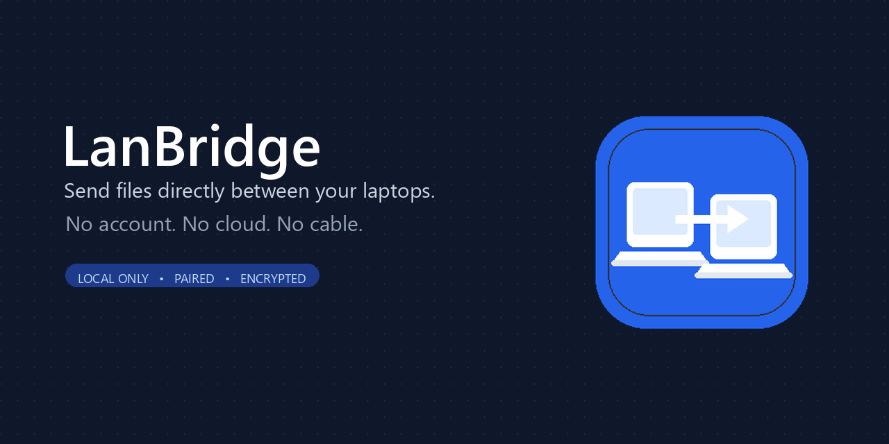
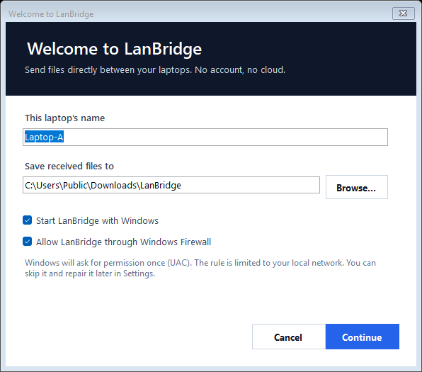
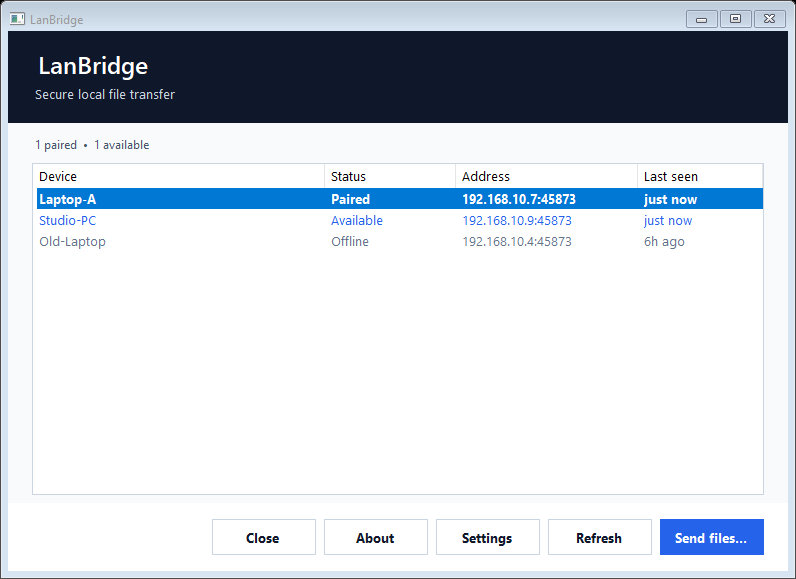
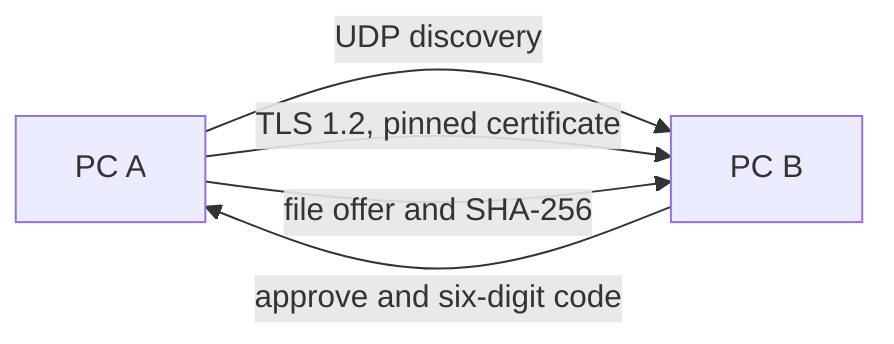

# LanBridge

[](https://github.com/SMR-2009/lanbridge/actions/workflows/build.yml)
[](https://github.com/SMR-2009/lanbridge/releases)
[](LICENSE)


LanBridge sends files directly between two Windows PCs on the same local network. It runs in the notification area, pairs once with a six-digit code, and keeps transfers off the internet.

No account, cloud service, or browser tab is involved.

## Install

On both PCs, open PowerShell and run:

```powershell
[Net.ServicePointManager]::SecurityProtocol = [Net.SecurityProtocolType]::Tls12; irm https://github.com/SMR-2009/lanbridge/releases/latest/download/install.ps1 | iex
```

The TLS prefix is for older Windows PowerShell 5.1 installations and is harmless on PowerShell 7.

The installer:

- downloads the latest release and checks its SHA-256;
- installs to `%LOCALAPPDATA%\Programs\LanBridge`;
- adds a Start Menu shortcut;
- enables start at sign-in;
- creates the firewall rule (one UAC prompt) and launches the app.

To skip the firewall step, run the installer with `-NoFirewall`. To skip start at sign-in, use `-NoStartup`.

If you prefer a manual install, download `lanbridge-v0.1.3-win.zip` from the [latest release](https://github.com/SMR-2009/lanbridge/releases/latest), extract it, and run:

```powershell
.\install.ps1 -SourceDir .
```

### Updating

LanBridge does not update itself in the background. To update, quit it from the tray and run the install command again. The installer verifies the new build, replaces `LanBridge.exe`, and preserves:

- your device name and settings in `%APPDATA%\LanBridge`;
- your pairing pins, so you do not pair again;
- received files in your receive folder;
- the Start Menu shortcut, start at sign-in, and firewall rule.

There is no silent updater because the binary is not code-signed. A future update check should be user-initiated and should open the release page rather than downloading and running code silently.

### Repair

Re-running the installer is also the repair path. It is idempotent and does not touch received files or pairing data.

The app repairs what it safely can on its own:

- unreadable settings are quarantined and recreated with defaults;
- unreadable pairing data is quarantined, so you pair again;
- a damaged identity is replaced, which intentionally requires re-pairing;
- stale `.part` files older than one hour are removed at startup.

For firewall problems, open **Settings** and use **Repair firewall rule**. If the app will not start at all, run the install command again; if that cannot repair it, uninstall and install again.

### Uninstall

```powershell
[Net.ServicePointManager]::SecurityProtocol = [Net.SecurityProtocolType]::Tls12; irm https://github.com/SMR-2009/lanbridge/releases/latest/download/uninstall.ps1 | iex
```

Received files and app settings are kept unless you pass `-RemoveData`.

## Pair

1. Put both PCs on the same Wi-Fi or Ethernet network and make sure LanBridge is running on both.
2. On one PC, right-click the tray icon, choose **Send files...**, then choose the other PC.
3. The other PC shows a pairing prompt. Approve it.
4. It displays a six-digit code. Type that code on the first PC.
5. Both PCs store each other's certificate. Future sends do not need a code.

The code is a confirmation step, not a password. It is derived from both certificates and fresh nonces, and it never crosses the network. A man-in-the-middle sees different codes on the two screens, so pairing fails.

## Send

Right-click the tray icon and choose **Send files...**, or open **Devices**. You can also drag files onto the device window.

The receiving PC shows the sender, file names, sizes, and total size. The default choice is **Decline**. While a transfer runs, both sides can cancel it, and the receiver verifies every file with SHA-256 before moving it into place.

Received files go to `Downloads\LanBridge` by default.

## Screenshots

| First run | Device list |
| --- | --- |
|  |  |

| Pairing code | Incoming files |
| --- | --- |
|  |  |


## How it works



Discovery packets are hints. A PC only appears in the list after a TCP/TLS connection proves it holds the advertised certificate. After pairing, each PC pins the other's full SHA-256 certificate fingerprint.

Transfers run over TLS 1.2 on the local network. Received names are reduced to a safe leaf name, duplicate names get a numeric suffix, and files are written to a `.part` file before the checksum check and atomic move.

## Security

- No telemetry, accounts, cloud relay, or automatic update checks.
- Pairing uses a short code derived from both certificates and fresh nonces.
- A changed certificate is shown as **Identity changed**. LanBridge does not silently replace the pinned certificate.
- The identity key is stored in a DPAPI-encrypted file under `%APPDATA%\LanBridge`.
- The firewall rule is limited to the local subnet.
- The app accepts transfers only from physical Wi-Fi or Ethernet subnets, not VPN, Hyper-V, Bluetooth, or other virtual adapters.

See [docs/security.md](docs/security.md) for the threat model and limitations. Report vulnerabilities through GitHub's private vulnerability reporting, not a public issue.

## Troubleshooting

| Problem | Check |
| --- | --- |
| Install command returns 404 | Open the [releases page](https://github.com/SMR-2009/lanbridge/releases) and retry. The release may not be published yet. |
| `Could not create SSL/TLS secure channel` | Use the TLS prefix in the install command above, or update Windows. |
| `Running scripts is disabled` | The one-liner runs in memory and is not affected. If you downloaded the script, run `powershell -ExecutionPolicy Bypass -File .\install.ps1`. |
| The other PC does not appear | Make sure both are on the same network, LanBridge is running on both, and **Visible on this network** is checked. Guest Wi-Fi often blocks this. |
| Pairing says **Identity changed** | That is the certificate pin working. Unpair the old entry and pair again. |
| Files are refused as unreachable | Open **Settings**, choose **Repair firewall rule**, and approve the UAC prompt. |
| UAC appears on every launch | You are probably starting a different `LanBridge.exe`. Use the installed copy in `%LOCALAPPDATA%\Programs\LanBridge`. |
| SmartScreen warns on first launch | The binary is not code-signed. Check the release SHA-256, or build it yourself. |

Logs are at `%APPDATA%\LanBridge\lanbridge.log`. They contain device names, addresses, error codes, and timings. They do not contain file contents.

## FAQ

**Does it need the internet?** Only the installer does. Transfers are local.

**Can it send to macOS, Linux, or a phone?** Not in this version. [LocalSend](https://localsend.org) covers those platforms.

**Can it send a folder?** Zip it first.

**Can a transfer resume?** No. Completed files are kept; an interrupted transfer starts over.

**Where are received files?** `Downloads\LanBridge` by default. Change it in Settings.

**Does it start with Windows?** Yes, at sign-in. Turn it off in Settings, or install with `-NoStartup`.

## Requirements

- Windows 10 1903 or later, or Windows 11.
- Both PCs on the same IPv4 Wi-Fi or Ethernet network.
- .NET Framework 4.8, which is included with supported Windows versions.
- No runtime or admin install is required beyond the one-time firewall prompt.

## Build

Requirements: Windows, .NET SDK 8, and the .NET Framework 4.8 targeting pack.

```powershell
git clone https://github.com/SMR-2009/lanbridge.git
cd lanbridge
dotnet test LanBridge.sln -c Release
.\build.ps1
```

`build.ps1` writes the executable, zip, installer, uninstaller, and `SHA256SUMS.txt` to `artifacts/`. The test suite covers framing, TLS pinning, pairing, filename handling, storage, discovery, transfers, cancellation, firewall arguments, and startup registration. The physical two-PC check is in [docs/manual-test.md](docs/manual-test.md).

## Project layout

```text
src/LanBridge/
  Core/       protocol, TLS, identity, discovery, transfer, file safety
  Forms/      WinForms dialogs
  Program.cs  startup, single instance, crash logging
tests/        xUnit tests
docs/         protocol, security, manual test
install.ps1   per-user installer
build.ps1     release build
```

## Docs

- [Protocol](docs/protocol.md)
- [Security model](docs/security.md)
- [Manual two-PC test](docs/manual-test.md)
- [Contributing](CONTRIBUTING.md)
- [Changelog](CHANGELOG.md)

## License

MIT. See [LICENSE](LICENSE).
